# API Spec: Sa7tein Irbid MVP (turunan flow)

Dokumen kebutuhan API untuk tim BE. Diturunkan dari **flow yang sudah digambar + matriks notifikasi + kode klien yang benar-benar jalan + skema backend live**, bukan karangan.

| | |
|---|---|
| Sumber kebenaran kontrak | `openapi.yaml` (DRAFT 0.1.0): `https://sa7tein-api.vercel.app/openapi.yaml` |
| Pemetaan flow ↔ endpoint/entity | `docs/design/flows/INDEX.json` §`contract` + §`trace` |
| Journey + matriks notifikasi | `docs/design/flows/BUSINESS.md` §2b (status `proposed`) |
| Backend live | Supabase PostgREST `https://dwzxtnfesmpobnepilhl.supabase.co` |
| Verifikasi skema | probe REST 2026-10-12 (anon + token CS, satu pass serial) |
| Status dokumen | draft kerja; item `UNRESOLVED` **jangan dikarang** |

**Aturan baca:** yang belum diputuskan PRD/kontrak ditandai **UNRESOLVED** + sumber. Jangan tebak (AGENTS.md §1, `docs/product/prd/manifest.json`).

---

## 0. Dua lapisan kontrak (baca ini dulu)

Ada **dua** definisi API yang hidup berdampingan:

1. **Gateway draft: `Sa7tein API v1` (`api.sa7tein.app`, belum dideploy).** Gaya REST rapi (`POST /orders`, `POST /orders/{id}/otp/verify`, dst). Ini **target** kontrak, dipakai di peta flow.
2. **Backend live: Supabase PostgREST.** Klien menembak tabel langsung (`{base}/rest/v1/<tabel>`), GoTrue untuk auth, Realtime untuk WS. Ini yang **sudah jalan di prod**.

Tabel di §5 menyajikan keduanya: **"PostgREST sekarang"** (yang klien panggil), **"Kontrak target"**, **"Wajib BE"** (delta). Gateway boleh menyusul; yang wajib sekarang: **tabel + RLS + policy + job**.

---

## 1. Konvensi

| Hal | Nilai |
|---|---|
| Base data | `https://dwzxtnfesmpobnepilhl.supabase.co/rest/v1/` |
| Auth (GoTrue) | `POST /auth/v1/token?grant_type=password` · `GET/PUT /auth/v1/user` |
| Realtime WS | `wss://.../realtime/v1/websocket?apikey=<anon>&vsn=1.0.0`, topic `realtime:public:<tabel>` |
| Header tulis | `apikey` + `Authorization: Bearer <jwt>` + `Prefer: return=representation` (saat butuh balik) |
| Token per peran | login GoTrue per akun; demo: `customer@` / `merchant@` / `courier@` / `cs@sa7tein.app`, password `demo1234` |
| Token "CS" (`refToken`) | dipakai klien untuk **penulisan lintas-peran** (notifikasi, chat) karena RLS membatasinya; lihat §6 G1/G3 |
| Push | Web Push (VAPID). Subscribe di `push_subscriptions`; fan-out = tugas BE (Edge Function) |
| Satuan uang | klien simpan **IDR sebagai source of truth**, JOD = tampilan. Kontrak menamai `amountJod`/`amountIdr`; penamaan belum sama (`INDEX.json:147`) |

**Realtime publication saat ini** (`src/api/realtime.ts:5-8`): `orders`, `merchants`, `menus`, `wallet_ledgers`, `disputes`, `couriers`, `batches`.
**TIDAK** termasuk: `notifications`, `checkpoints` → klien polling. Konsekuensi BE: §5.7.

---

## 2. Skema data nyata (terverifikasi 2026-10-12)

Kolom di bawah = `Object.keys` baris nyata (tabel berisi). Tabel kosong kolomnya belum terbaca: §2.2.

### 2.1 Inventaris tabel + kolom

**Identitas**
```
users (13)
  id, auth_user_id, role, email, phone, verified, status, auth_provider,
  created_at, name, dob, gender, avatar
customers (7)
  id, user_id, name, risk_flag, created_at, avatar, status
customer_risk_flags (5)
  id, customer_id, reason, by_operator_id, at
addresses (17)
  id, user_id, label, address, latitude, longitude, is_default, zone_id,
  zone_code, created_at, name, building, floor, unit, notes, city, full_address
push_subscriptions (*)   -- kosong
```

**Merchant & katalog**
```
merchants (28)
  id, user_id, store_name, store_phone, store_address, latitude, longitude,
  description, photo, delivery_config, tenant_status, deposit_jod,
  deposit_status, created_at, store_status, rating_avg, rating_count,
  open_time, close_time, owner, owner_phone, city, tier, is_active_hijazi,
  is_active_syimali, cod_issues, approved_at, status_reason
menus (14)
  id, merchant_id, name, description, price_jod, available, image, stock,
  category, created_at, cook_minutes, discount_percent, is_popular, calories
menu_variants (7)
  id, menu_id, name, required, max_select, options, created_at
couriers (14)
  id, user_id, merchant_id, name, availability, latitude, longitude,
  last_seen_at, photo, vehicle, created_at, phone, phone_verified,
  active_order_count
```

**Order**
```
orders (30)
  id, code, status, customer_id, merchant_id, delivery_address_id, batch_id,
  courier_id, sub_total_jod, delivery_fee_jod, platform_fee_jod, tip_jod,
  promo_amount_jod, total_jod, total_idr, zone_id, zone_code, promo_id,
  payment_method, payment_status, paid_at, hold_status, created_at, placed_at,
  cancel_reason, cancel_by, order_note, otp, otp_verified, cook_minutes
checkpoints (8)
  id, order_id, kind, latitude, longitude, proof_photo, note, at
order_items (*)          -- ADA tapi kosong
batches (*)              -- ADA tapi kosong
```

**Uang**
```
wallets (5)
  id, user_id, balance_jod, reserved_balance_jod, updated_at
wallet_ledgers (*)       -- ADA tapi kosong
wallet_holds (*)         -- ADA tapi kosong
topups (*)               -- ADA tapi kosong
cashouts (*)             -- ADA tapi kosong
fees (*)                 -- ADA tapi kosong
taxes (*)                -- ADA tapi kosong
exchange_rates (*)       -- ADA tapi kosong
deposits (8)
  id, merchant_id, kind, amount_jod, status, verified_by, verified_at, created_at
merchant_credits (9)
  id, merchant_id, balance_jod, rebate_tier, rebate_period,
  rebate_amount_jod, rebate_paid_at, non_withdrawable, updated_at
merchant_credit_events (5)
  id, merchant_id, event, amount_jod, at
cashback_tiers (6)
  id, tier, min_volume_jod, pct, threshold_orders, amount_jod
protection_fund (*)      -- ADA tapi kosong
```

**Chat**
```
chats (5)
  id, order_id, last_message, last_at, created_at
chat_messages (7)
  id, chat_id, sender_id, channel, body, at, read_at
chat_participants (*)    -- ADA tapi kosong (belum terpetakan di flow!)
```

**Notifikasi**
```
notifications (9)
  id, user_id, kind, title, body, sound, read, created_at, audience
```

**Dispute, rating, platform**
```
disputes (*)             -- ADA tapi kosong
rating_reviews (11)
  id, order_id, customer_id, merchant_id, menu_id, rating, review,
  window_closes_at, edited_at, deleted_at, created_at
review_replies (*)       -- ADA tapi kosong
zones (5)
  id, code, name, polygon, created_at
roles (4)
  id, key, name, permissions
operators (6)
  id, user_id, role_id, active, created_by, created_at
platform_switches (4)
  key, enabled, updated_at, updated_by
audit_logs (*)           -- ADA tapi kosong
tax_reports (*)          -- ADA tapi kosong
platform_profit (*)      -- ADA tapi kosong
phone_verifications (*)  -- ADA tapi kosong
```

### 2.2 Tabel kosong, kolom belum terbaca

`order_items` · `batches` · `wallet_ledgers` · `wallet_holds` · `topups` · `cashouts` · `fees` · `taxes` · `exchange_rates` · `protection_fund` · `chat_participants` · `disputes` · `dispute_appeals` · `review_replies` · `audit_logs` · `tax_reports` · `platform_profit` · `phone_verifications` · `push_subscriptions`

**Aksi BE:** konfirmasi kolom final untuk tabel-tabel ini (spec kolom di §5 berdasarkan kebutuhan flow + nama yang dipakai klien; anggap **usulan**, bukan fakta). OpenAPI PostgREST hanya bisa dibaca `service_role`, jadi tak bisa ditarik dari sini.

### 2.3 Tabel absen (404 `PGRST205`)

| tabel | dipakai flow | wajib? |
|---|---|---|
| `incident_resolutions` | f15, f24 | **ya** (jejak tutup insiden CS) |
| `liabilities` | f7, f15, f22 | view dari `wallet_ledgers` (boleh tanpa tabel) |

### 2.4 Referensi yatim (kolom ada, tabel tak ada)

| kolom | seharusnya menunjuk | masalah |
|---|---|---|
| `orders.promo_id`, `orders.promo_amount_jod` | tabel promo/kupon | **tak ada tabel promo**; promo belum ada di flow mana pun. BE putuskan: buat tabel atau buang kolomnya (`UNRESOLVED`). |
| `orders.batch_id` | `batches` | tabel ada, kosong; `batches` ada di trace `C-17`. |
| `orders.otp`, `orders.otp_verified` | kripto OTP | **predictable** (`1000 + 7*id`) & **terbaca kurir/merchant**; lihat §5.5.1 |
| `notifications.order_id` (tidak ada) | tautan ke order | notifikasi **tak bisa** deep-link ke order; lihat §5.7 butir G3. |
| riwayat status order (tidak ada) | `C-17` `order_status_changed` | tak ada `order_status_history`; audit transisi status belum ada. |

### 2.5 Relasi (FK turunan dari penamaan, perlu dikonfirmasi BE)

```
users.id ──< addresses.user_id
users.id ──< push_subscriptions.user_id
users.id ──< merchants.user_id
users.id ──< couriers.user_id
users.id ──< wallets.user_id
users.id ──< notifications.user_id
users.id ──< operators.user_id ; users.id ──< operators.created_by
users.id ──< chat_messages.sender_id
users.id ──< customers.user_id
customers.id ──< orders.customer_id
customers.id ──< customer_risk_flags.customer_id ; users.id ──< customer_risk_flags.by_operator_id
merchants.id ──< menus.merchant_id ──< menu_variants.menu_id
merchants.id ──< couriers.merchant_id
merchants.id ──< merchant_credits.merchant_id
merchants.id ──< merchant_credit_events.merchant_id   -- events tidak ber-FK ke credits
merchants.id ──< deposits.merchant_id
zones.id ──< addresses.zone_id ; zones.id ──< orders.zone_id
addresses.id ──< orders.delivery_address_id
batches.id ──< orders.batch_id
couriers.id ──< orders.courier_id
merchants.id ──< orders.merchant_id
orders.id ──< order_items.order_id
orders.id ──< checkpoints.order_id
orders.id ──< chats.order_id ──< chat_messages.chat_id
orders.id ──< disputes.order_id
orders.id ──< rating_reviews.order_id ──< review_replies.review_id
roles.id ──< operators.role_id
```

### 2.6 Contoh payload live (rujukan bentuk data)

```jsonc
// merchants (delivery_config = jsonb)
{ "id":1, "user_id":2, "store_name":"Warung Sate Pak Ali", "store_phone":"+962790000002",
  "delivery_config": { "mode":"radius", "activeZones":["Hijazi","Syimali"], "radiusMeters":2000 },
  "tenant_status":"approved", "deposit_jod":8.5, "deposit_status":"held",
  "store_status":"open", "rating_avg":4.81, "rating_count":67,
  "tier":"founding", "is_active_hijazi":true, "is_active_syimali":true, "cod_issues":0 }

// zones.polygon = array titik [lat, lng]
{ "id":1, "code":"Hijazi", "name":"Hijazi",
  "polygon":[[32.52,35.82],[32.58,35.82],[32.58,35.9],[32.52,35.9]] }

// platform_switches (3 baris)
{ "key":"cod_enabled", "enabled":true }
{ "key":"payout_enabled", "enabled":true }
{ "key":"maintenance_mode", "enabled":false }

// roles.permissions = text[]
{ "key":"cs_ops",   "permissions":["tenant.approve","tenant.reject","dispute.level1","cod.blacklist","liability.read","escalate.handle"] }
{ "key":"sa_ops",   "permissions":["zone.edit","audit.read","tax.read","profit.read","ledger.read","user.read"] }
{ "key":"sa_owner", "permissions":[... di atas ...,"role.manage","operator.manage","profit.withdraw","switch.toggle","tenant.status","appeal.decide"] }

// deposits.kind ∈ founding_credit | cod ; status ∈ held (contoh)
{ "id":1, "merchant_id":1, "kind":"founding_credit", "amount_jod":5,   "status":"held" }
{ "id":2, "merchant_id":1, "kind":"cod",             "amount_jod":3.5, "status":"held" }

// checkpoints punya bukti (dipakai panel dispute)
{ "id":7, "order_id":801, "kind":"otp_verified", "latitude":null, "longitude":null, "proof_photo":null, "note":null, "at":"2026-10-10T03:11:53Z" }

// chat_messages (kanal klien)
{ "id":8, "chat_id":9, "sender_id":1, "channel":"courier-customer", "body":"Tolong titip ke satpam", "at":"2026-10-12T11:56:19Z", "read_at":null }
```

---

## 3. Authz: siapa boleh apa

Sumber: `roles.permissions` (nyata) + batas peran `DEC-2003` (CS menangani, SA mengawasi).

| Resource | customer | merchant | courier | CS (`cs_ops`) | SA (`sa_ops`/`sa_owner`) |
|---|---|---|---|---|---|
| `orders` | baca miliknya | baca/kelola order tokonya | baca tugasnya; tulis checkpoint | baca semua (triage) | baca semua |
| `chats` / `chat_messages` | peserta order | peserta order | peserta order | baca semua (sengketa) | baca semua |
| `notifications` | inbox sendiri | inbox sendiri | inbox sendiri | inbox CS (`audience='cs'`) | inbox + queue |
| `disputes` | buat + baca miliknya | buat + baca miliknya | baca (info) | `dispute.level1` (putuskan) | `appeal.decide` |
| `merchants` (approval) | tidak | kelola profilnya | tidak | `tenant.approve` / `tenant.reject`, `cod.blacklist` | `tenant.status` |
| `customers` / `customer_risk_flags` (risiko) | baca statusnya sendiri | tidak | tidak | `cod.blacklist` (tandai/cabut) | `tenant.status` (audit) + banding |
| `wallets` / `wallet_ledgers` | miliknya | `merchant_credits` | tips-nya | `liability.read` | `ledger.read`, `profit.read`/`withdraw` |
| `platform_switches` | tidak | tidak | tidak | tidak | `switch.toggle` |
| `zones` | baca | baca | baca | tidak | `zone.edit` |
| `roles` / `operators` | tidak | tidak | tidak | tidak | `role.manage`, `operator.manage` |
| `audit_logs` / `tax_reports` / `platform_profit` | tidak | tidak | tidak | `tax.read`/`profit.read` (SA) | `audit.read`, `tax.read`, `profit.read` |

**Aksi BE:** RLS harus membaca peran dari `users.role` / `operators.role_id` → `roles.permissions` (bukan hardcode di klien). Klien saat ini banyak memakai token CS untuk lintas-peran: itu **hack**, wajib diganti policy peserta (§6 G1).

---

## 4. Yang WAJIB disediakan BE (ringkas: delta)

| # | Wajib | Kenapa (flow) | Bagian |
|---|---|---|---|
| G1 | **RLS chat peserta.** Hari ini hanya sesi CS yang boleh INSERT `chat_messages`; customer insert = `403`. `chat_participants` ada tapi kosong | f14 | §5.6 |
| G2 | **Job/timer SLA + escalation.** Breach dari `placed_at` (ambil>15m · berangkat>30m · tiba>10m · auto-settle>10m) → emit `notifications` audience `cs`/`merchant`/`courier` | f24, f11, f1 | §5.5, §8 |
| G3 | **Emit notifikasi per langkah** (customer/merchant/kurir) **dan audience `cs`**. `audience:'cs'` valid, **0 pemanggil**; recipient wajib dari **peserta order**, bukan id hardcode | f1, f11, f24 | §5.7, §7 |
| G4 | **Ledger append-only + hold lifecycle.** Reserve/cut/settle/release; **reversal = entry baru**, bukan edit | f2, f7 | §5.4 |
| G5 | **Dispute lifecycle.** `disputes` kosong: butuh status/enum, `resolve`, `appeals`, freeze hold + **pause auto-settle** | f8, f24, f22 | §5.8 |
| G6 | **OTP server.** Generate: sudah ada tapi **predictable** (`1000 + 7*id`); `otp_verified` tak pernah true; `orders.otp` **bisa dibaca kurir & merchant** (self-verify). Lihat §5.5.1 | f1, f5, f13 | §5.5.1 |
| G7 | **`order_items` diisi.** Tabel ada, nol baris | f1, f12 | §5.3 |
| G8 | **`incident_resolutions` dibuat** (jejak tutup insiden CS) | f24, f15 | §2.3, §5.8 |
| G9 | **`notifications` + `checkpoints` masuk publikasi Realtime** (atau setujui polling 5s) | f11 | §1, §5.7 |
| G10 | **Geofence server.** `zones.polygon` ada (array `[lat,lng]`) → `POST /coverage/resolve` | f20, f16 | §5.2 |
| G11 | **Webhook Xendit + idempotency** (`POST /webhooks/xendit`, retry, VA expiry) | f17 | §5.4 |
| G12 | **Auth level-1.** `phone_verifications` ada; tanpa OTP WA (validasi E.164), fallback `wa.me` | f21 | §5.1 |
| G13 | **`notifications.order_id`** (atau `ref`) supaya tap notifikasi bisa membuka order | f11 | §2.4, §5.7 |
| G14 | **`order_status_history`** (audit transisi status, event `order_status_changed`) | f18 | §2.4 |
| G15 | **Tabel promo** atau buang `orders.promo_id`/`promo_amount_jod` | (tidak ada di kontrak) | §2.4 |

### Target RLS per tabel (wajib)

| tabel | policy minimal |
|---|---|
| `orders` | SELECT: customer miliknya, merchant tokonya, kurir tugasnya, CS/SA semua. **Kolom `otp` dilarang untuk kurir/merchant** (hanya customer pemilik). UPDATE: merchant (status terbatas), kurir (`courier_id` terbatas), CS |
| `chat_messages` | SELECT/INSERT hanya **peserta** (`chat_participants.user_id = auth uid`); non-peserta ditolak |
| `chats` | SELECT/INSERT peserta; thread dibuat saat order `placed` |
| `checkpoints` | INSERT: kurir pemilik order; SELECT: peserta + CS |
| `wallets` | SELECT miliknya; tidak ada UPDATE langsung dari klien (hanya lewat fungsi/ledger) |
| `wallet_ledgers` / `wallet_holds` | **tanpa** tulis klien; hanya fungsi server (append-only) |
| `notifications` | SELECT miliknya (`user_id` atau `audience`); INSERT lewat fungsi server |
| `disputes` | INSERT pengaju order; SELECT pihak + CS/SA; UPDATE hanya CS/SA |
| `customers` / `customer_risk_flags` | SELECT: customer miliknya (via `customers.user_id`); flag INSERT/UPDATE **hanya CS** (`cod.blacklist`), histori append-only; SA audit + banding |
| `platform_switches`, `roles`, `operators`, `audit_logs`, `tax_reports`, `platform_profit` | SELECT/UPDATE hanya SA (`sa_ops`/`sa_owner`) |

---

## 5. Endpoint per domain

Format: **PostgREST sekarang** → **kontrak target** → **wajib BE**.

### 5.1 Auth & identitas: f21-account-auth

| Aksi | PostgREST sekarang | Kontrak target | Wajib BE |
|---|---|---|---|
| Login | `POST /auth/v1/token?grant_type=password` | `POST /auth/login` | ada |
| Sesi/me | `GET /auth/v1/user` | `GET /auth/me` | ada |
| Ubah profil | `PUT /auth/v1/user` + `PATCH users?id=eq.<id>` | (tidak ada di kontrak) | ada |
| Pemetaan auth ke domain | `GET users?select=id&auth_user_id=eq.<uuid>` | (internal) | ada (`users.auth_user_id`) |
| Profil customer | `GET customers?select=*&user_id=eq.<users.id>` | (internal) | ada (`customers.user_id`; `orders.customer_id` → `customers.id`, **bukan** `users.id`) |
| Nomor WA (E.164) | insert `phone_verifications` (kosong; klien belum menulis) | `POST /auth/phone/verification` + `POST /auth/phone/verify` | **belum** (G12); Level 1 validasi format, **tanpa** OTP WA |
| Google | belum | `POST /auth/google` | **belum** (`AUT-1` UNRESOLVED) |

`users.role` nilai nyata: `cs` (contoh). `auth_provider` contoh `phone`. Level 2 WA Business API **tidak dipakai** (PO 2026-09-23) → fallback `wa.me` manual.

### 5.2 Katalog, merchant, zona: f12 / f16 / f20

| Aksi | PostgREST sekarang | Kontrak target | Wajib BE |
|---|---|---|---|
| Daftar toko | `GET merchants?select=*&order=id.asc` | (tidak ada) | ada |
| Menu | `GET menus?...` + `GET menu_variants?menu_id=in.(...)` | (tidak ada) | ada |
| Profil toko | `GET merchants?select=store_name,...,delivery_config&id=eq.<id>` | (tidak ada) | ada |
| Buka/tutup toko | `PATCH merchants?id=eq.<id>` `{store_status}` | (tidak ada) | ada |
| Kurir toko | `GET couriers?merchant_id=eq.<id>` + `GET users?id=in.(...)` | `GET /merchants/{id}/couriers` | ada |
| Kelola order | `GET orders?merchant_id=eq.<id>` + `PATCH orders.status` | `GET /orders?merchantId=` + `POST /orders/{id}/accept\|reject\|prepare\|ready` | enum §7; aksi granular **belum** |
| Zona | `GET zones?select=*&order=id.asc` | `POST /coverage/resolve` | **belum** (G10); geofence dari `zones.polygon` + `merchants.delivery_config` |
| Address | `GET/POST/PATCH/DELETE addresses?...` | `POST /me/addresses` | ada |
| Switch platform | `GET platform_switches?select=key,enabled` | `GET/PATCH /superadmin/switches` | ada |

**Contoh request/response (usulan kontrak):**

```jsonc
// POST /me/addresses
// req
{ "label":"Rumah", "name":"Rumah", "building":"Green View Apartment", "floor":"3", "unit":"A2",
  "notes":"Titip ke resepsionis", "city":"Irbid", "full_address":"Jl. Irbid No. 2, Irbid",
  "latitude":32.544, "longitude":35.844, "is_default":true }
// res 201
{ "id":2, "user_id":13, "zone_code":"Hijazi", "is_default":true, "...":"..." }

// POST /coverage/resolve
// req
{ "merchantId":1, "latitude":32.544, "longitude":35.844, "zoneCode":"Hijazi" }
// res
{ "covered":true, "zone":{ "code":"Hijazi" }, "distanceMeters":1180, "mode":"radius", "radiusMeters":2000 }
```

### 5.3 Order: f1-order-lifecycle / f18-order-state

| Aksi | PostgREST sekarang |
|---|---|
| Buat order | `POST orders` `{code, customer_id, merchant_id, delivery_address_id, sub_total_jod, delivery_fee_jod, platform_fee_jod, total_jod, payment_method, zone_code}` |
| Ubah status | `PATCH orders?id=eq.<oid>` `{status}` |
| Assign kurir | `PATCH orders?id=eq.<oid>` `{courier_id}` |
| Checkpoint | `POST checkpoints` `{order_id, kind}` |
| List per peran | `GET orders?...&merchant_id=eq.<id>` / `&courier_id=eq.<id>` / `?select=id,code,status&id=eq.<oid>` |

**Wajib BE:**
- **`order_items` diisi** (G7) supaya detail pesanan & fee per baris bisa diaudit (`f1:checkout`, `f12`). Bentuk usulan: `(id, order_id, menu_id, name, price_jod, qty, modifiers jsonb, subtotal_jod)`.
- Status enum + transisi (§7). `placed` vs `quotation` = **OST-1 UNRESOLVED**.
- `orders.batch_id` (kosong di trace `C-17`): putuskan apakah batching dipakai.
- **`order_status_history`** (G14) untuk event `order_status_changed`.
- Batas cancel & fee post-match **UNRESOLVED** (`f18`, usul ≤10 mnt).

```jsonc
// POST /orders (target), bentuk mendekati kolom nyata
{ "code":"SA-...", "customer_id":1, "merchant_id":1, "delivery_address_id":1,
  "items":[{"menu_id":9,"qty":2,"modifiers":[]}],
  "sub_total_jod":7.0, "delivery_fee_jod":0.22, "platform_fee_jod":0.37, "tip_jod":0,
  "total_jod":7.59, "payment_method":"cod", "zone_code":"Hijazi" }
// res
{ "id":807, "status":"cart", "hold_status":"none", "otp":"(dibuat BE; jangan diandalkan, §5.5.1)", "otp_verified":false,
  "placed_at":null, "created_at":"..." }
```

### 5.4 COD hold, wallet, ledger, pembayaran: f2 / f3 / f6 / f7 / f17

| Kebutuhan | PostgREST sekarang | Kontrak target | Wajib BE |
|---|---|---|---|
| Wallet | `GET wallets?select=user_id,balance_jod,reserved_balance_jod&user_id=eq.<id>` | `GET /wallet` | ada |
| Hold COD | klien **tidak** tulis `wallet_holds` (mock) | `GET /wallet/holds` | **belum** (G4); reserve saat order, **cut saat match**, settle saat OTP, release/reverse saat batal |
| Ledger | klien tidak tulis | `GET /ledger` | **belum**; append-only, reversal = entry baru, **tanpa** UPDATE/DELETE |
| Top-up | `topups` ada (kosong); klien hanya baca | `POST /wallet/topups` + `GET /wallet/topups/{id}` | **belum** |
| Cash-out | `cashouts` ada (kosong) | `POST /wallet/cashouts` | **belum**; `f6`, Xendit `POST /v3/payouts` + webhook `v3_payout.*` |
| Pembayaran | `orders.payment_method ∈ {cod, transfer, xendit_va, xendit_qris}`; `payment_status`, `paid_at` ada | `POST /webhooks/xendit` | **belum** (G11); idempotency, retry, VA expiry = **UNRESOLVED** (`WEB-1`) |
| Liability | (tidak dipanggil) | `GET /admin/liability` | **belum**; `liabilities` 404, buat view dari `wallet_ledgers` |
| Fee & pajak | `fees`/`taxes` kosong | `GET /superadmin/tax-reports` | fee flat **0,37 JOD** (PO 2026-09-22); pajak **UNRESOLVED** (`TAX-1/2`) |
| Insentif | `merchant_credits` + `merchant_credit_events` ada | (tidak ada) | tulis event kredit (Founding 5 JOD, I-2); tier **UNRESOLVED** (`I-5`) |
| Kurs | `exchange_rates` kosong | (tidak ada) | `f10`, `OQ-26/28` UNRESOLVED |

Bentuk usulan `wallet_ledgers` (append-only): `(id, user_id, ref_type, ref_id, direction cr/db, amount_jod, balance_after_jod, note, at)`, dengan `ref_type ∈ topup|order|hold|cut|settle|release|reversal|tip|cashout|credit|fee|refund`.
Bentuk usulan `wallet_holds`: `(id, order_id, customer_id, amount_jod, status held|cuts|settled|released|reversed, created_at, settled_at)`.

### 5.5 Verifikasi kirim, checkpoint, SLA: f5 / f13

| Kebutuhan | PostgREST sekarang | Kontrak target | Wajib BE |
|---|---|---|---|
| Checkpoint | `POST checkpoints` `{order_id, kind}` (+ `latitude`,`longitude`,`proof_photo`,`note` tersedia) | `POST /orders/{id}/checkpoints` | ada |
| Ambil/terima tugas | `PATCH orders.status` | `POST /orders/{id}/courier/accept` | ada (status) |
| OTP | BE **sudah mengisi** `orders.otp` (4 digit) saat order dibuat; verify belum ada | `POST /orders/{id}/otp/verify` | **belum** (G6); lihat §5.5.1 (generate, kebocoran kolom, verify) |
| Timer SLA | seed statis di UI | (tidak ada) | **belum** (G2); hitung dari `placed_at`, emit alert (§7, §8) |

Konstanta SLA = keputusan PO **sementara** (OQ-13), dipakai kode (`src/data/courier.ts:94-114`):

```
COURIER_SLA_MINUTES = { ambil: 15, berangkat: 30, tiba: 10 }   // dari placed_at
AUTO_SETTLE_MINUTES = 10                                        // timeout OTP -> tetap settle
COURIER_GUARD_MINUTES = { call: 5, batal: 10 }
```

`SLA-1` **unresolved** (angka final menunggu data rute; editor SLA belum diputuskan). Angka di atas cukup untuk membangun timer sekarang.

#### 5.5.1 OTP: generate, kebocoran kolom, verify (G6)

**Fakta terverifikasi 2026-10-12** (token CS/kurir/merchant, order 796..810):

- BE **sudah** mengisi `orders.otp` (4 digit) saat order dibuat, termasuk saat status masih `cart`.
- Nilainya **berpola**: 6 order terakhir (id 805..810) = `6635, 6642, 6649, 6656, 6663, 6670`, naik tetap **+7 per id**. Rumusnya `otp = 1000 + 7 * id`. **Bukan acak**: OTP bisa dihitung siapa pun yang tahu `order.id`.
- `otp_verified` **tak pernah `true`**, walau status `done` (contoh id 809 `done`, `otp_verified=false`), jadi jalur verify belum dijalankan.
- **Kebocoran kolom:** RLS mengizinkan kurir & merchant `GET orders?select=id,otp`. Terbukti: kurir membaca order 801 → `6607`, merchant order 796 → `6572` (dua-duanya cocok rumus di atas). Artinya **kurir bisa memverifikasi sendiri** tanpa customer.

**Wajib BE:**

| Hal | Ketentuan |
|---|---|
| Generate | saat order dibuat (`placed`/`payment_confirmed`), pakai **CSPRNG**, **bukan** sequence/hash `order.id` |
| Simpan | **hash** (`sha256` + salt) atau pindah ke tabel/fungsi terpisah; jangan plaintext di `orders` |
| Ekspos | **hanya** customer pemilik order yang boleh membaca OTP (tampil in-app). Kurir & merchant **dilarang** (butuh column-level privilege / view / RPC) |
| Verifikasi | `POST /orders/{id}/otp/verify {code}`; sukses → `orders.otp_verified=true` + `checkpoints.kind='otp_verified'` + hold `settled` + event `otp_verified` |
| Gagal | 4xx, tanpa ubah state; hitung percobaan |
| Timeout | `AUTO_SETTLE_MINUTES = 10` → settle tanpa OTP (F5: order tak boleh menggantung) |

**UNRESOLVED (jangan dikarang):** jumlah digit (4 atau 6), masa berlaku OTP, batas percobaan + lockout, kirim ulang, dan tampilan OTP sisi customer (`otpDisplayCode` di mock).

### 5.6 Chat: f14-chat-order

**Klien sekarang** (`src/api/chat.ts`):
- Pastikan thread: `GET chats?select=id&order_id=eq.<orderId>&limit=1`; buat bila kosong `POST chats {order_id}`.
- Baca: `GET chat_messages?select=id,sender_id,body,at&chat_id=eq.<chatId>&order=id.asc&limit=100`.
- Kirim: `POST chat_messages {chat_id, sender_id, body, channel}`, `channel='courier-customer'`, `sender_id` = `users.id` (bigint).

**Kontrak target:** `GET /orders/{id}/chat` · `POST /orders/{id}/chat/messages`; events `chat_opened`, `courier_joined_chat`, `message_created`.

**Wajib BE (G1), gap keras:**
- RLS `chat_messages` hanya izinkan sesi CS → **customer insert = `403`**. Pesan tetap tersimpan (terbukti e2e) karena klien memakai token CS, tapi arsitekturnya salah.
- **`chat_participants` ada dan kosong.** Ini tempat yang benar: isi peserta thread (customer, merchant, kurir) dan jadikan dasar RLS. Usulan kolom: `(chat_id, user_id, role, joined_at)`.
- Aturan flow (`f14`): thread dibuat saat **order placed**; peserta **≤3**; kurir masuk saat `courier_match`; read-only setelah `done` + N hari (**N UNRESOLVED**); `dispute_opened` menaikkan prioritas thread (**flag**, bukan thread baru).
- **Temuan samping (perlu dibersihkan):** ada `chat_messages` yatim, `chat_id=8` dan `chat_id=9`, sementara `chats` hanya punya id 5 (order 806) dan 7 (order 796). Sisa uji e2e. **BE harap hapus atau abaikan**; jangan jadikan acuan.
- Notifikasi chat masuk (push): **belum dipastikan** (UNRESOLVED f14).

```jsonc
// GET /orders/796/chat (target)
{ "chatId":7, "orderId":796, "participants":[{ "userId":1,"role":"customer" },{ "userId":3,"role":"courier" }],
  "messages":[{ "id":9,"senderId":1,"body":"Tolong titip ke satpam","channel":"courier-customer","at":"...","readAt":null }] }
```

### 5.7 Notifikasi & push: f11-push-notification

| Kebutuhan | PostgREST sekarang | Kontrak target | Wajib BE |
|---|---|---|---|
| Simpan notif | `POST notifications` `{user_id, audience, kind, title, body, sound, read}` (klien via token CS) | (tidak ada) | ada; **recipient dari peserta order** (G3) |
| Baca inbox | `GET notifications?audience=in.(<aud>,all)&order=created_at.desc&limit=50` | (tidak ada) | ada |
| Tandai baca | `PATCH notifications?id=eq.<id>` / `?audience=eq.<aud>&read=eq.false` | (tidak ada) | ada |
| Subscribe push | `GET/POST/DELETE push_subscriptions` | `POST /push/subscriptions` | ada |
| Fan-out push | (tidak dipanggil) | (internal) | **belum**; Edge Function baca `push_subscriptions` → kirim Web Push (payload ≤4 KB, TTL wajib, `userVisibleOnly`, **silent dilarang**) |
| Fallback WA | (tidak dipanggil) | (internal) | `wa.me` manual; nomor E.164 dari `users.phone` |
| Realtime | `notifications` tak di publikasi → polling 5s | (internal) | **belum** (G9) |
| Deep-link | `notifications` **tak punya** `order_id` | (internal) | **belum** (G13); tambah `order_id`/`ref` |

`kind` ∈ `order | promo | payment | courier | system` (`src/types.ts:396`); `audience` ∈ `customer | merchant | courier | cs` (`src/types.ts:399`).

### 5.8 Dispute, CS, eskalasi: f8 / f24 / f15 / f22

| Kebutuhan | PostgREST sekarang | Kontrak target | Wajib BE |
|---|---|---|---|
| Buka sengketa | klien mock; `disputes` kosong | `POST /disputes` | **belum** (G5); tulis + status + flag hold |
| Resolusi | (tidak dipanggil) | `POST /disputes/{id}/resolve` | **belum**; 4 resolusi (refund penuh / sebagian / release / tolak); tiap putusan = **1 entry ledger baru** |
| Banding | (tidak dipanggil) | `POST /disputes/{id}/appeals` | **belum**; `APL-1` UNRESOLVED; MVP 1 banding, diputus **SA** |
| Freeze + pause auto-settle | (tidak dipanggil) | (internal) | **belum**; order → `disputed`, tak boleh `settled` |
| Queue CS + jejak | (tidak dipanggil) | (internal) | **belum** (G8); `incident_resolutions` 404 |
| Escalation timer | seed statis | (internal) | **belum** (G2) |

Usulan kolom `disputes`: `(id, order_id, filed_by, filed_role, category, reason, photos text[], status open|under_review|resolved_refund|resolved_partial|resolved_release|rejected|appealed, resolution_note, resolved_by, resolved_at, created_at)`.
Usulan kolom `incident_resolutions`: `(id, order_id nullable, dispute_id nullable, kind, actor_id, action, note, ledger_ref, created_at)`.

Batas peran (`R-NOTIF-02`, `DEC-2003`): **CS menangani** (sengketa, batal post-match, SLA lewat); **SA hanya eskalasi** (dispute macet, protection fund, appeal). Happy path **tidak** mengirim apa pun ke CS. `protection_fund` = 2% fee platform (OQ-12 closed).

### 5.9 Rating & review: f19

| Kebutuhan | PostgREST sekarang | Kontrak target | Wajib BE |
|---|---|---|---|
| Simpan review + tip | `rating_reviews` ada (+ `window_closes_at`,`edited_at`,`deleted_at`) | `POST /orders/{id}/review` | **belum**; tip 100% ke kurir, masuk ledger |
| Balas review | `review_replies` kosong | `POST /reviews/{id}/reply` | **belum**; `RATE-1/2` UNRESOLVED |
| Agregat | `merchants.rating_avg`/`rating_count` ada (stale?) | (internal) | perlu trigger/refresh saat review masuk |

### 5.10 Super Admin: f22 (website penuh, non-PWA)

`GET/PATCH /superadmin/switches` · `GET /superadmin/tax-reports` · `GET /superadmin/platform-profit` · `GET /superadmin/users` · `GET /superadmin/users/merchant/{id}` · `PATCH /superadmin/tenants/{id}/status`.

PostgREST punya: `platform_switches` (3 switch nyata), `roles`, `operators`, `zones`, `audit_logs`, `tax_reports`, `platform_profit`. Belum: `liabilities` (404), audit trail keputusan (`AUD-1` UNRESOLVED), tarif pajak final.

### 5.11 Risiko customer & blacklist COD: f15 / f24 / f2

Ini topik yang diminta diklarifikasi (flagging customer risk, eskalasi admin, review). **Review** ada di §5.9; **eskalasi admin** di §5.8. Untuk risiko customer: klien **sudah** memodelkannya, dan BE **ternyata sudah punya tabelnya** (ditemukan saat verifikasi 2026-10-12; di luar probe awal).

| Hal | Di klien | Di BE (nyata) |
|---|---|---|
| Keadaan | `CustomerStatus = active \| suspended \| blacklisted` | `customers.status` (contoh `active`) + `customers.risk_flag` (bool) |
| Riwayat flag | `CustomerRiskFlag { id, customerId, reason, at, byOperatorId }` (`src/types.ts:189`), slice `adminSlice.customerRiskFlags`, helper `hasRiskFlag()` | `customer_risk_flags (id, customer_id, reason, by_operator_id, at)` — 1 baris: customer 6, "COD gagal 2× berturut", operator 4 |
| Riwayat COD | `Merchant.codIssues` | `merchants.cod_issues` |
| Izin | aksi CS | `roles.permissions.cod.blacklist` (CS) |
| Event | — | `cod_blocked` (`INDEX.json`, `C-12`) |

**Efek ganda.** Blacklist COD menandai **dua sisi sekaligus**: `merchants.tenant_status='blacklisted'` (atau `suspended`) **dan** `customers.risk_flag`/`customers.status` + satu baris `customer_risk_flags`. Mencabutnya harus menyentuh keduanya (`src/pages/SaMerchantDetail.tsx:55`). Karena itu pencabutan tetap kerja panel CS; SA hanya audit + menangani banding.

**Kontrak target (usulan, belum ada endpoint):** `POST /customers/{id}/flags { reason }` · `POST /customers/{id}/flags/{flagId}/revoke` · `PATCH /customers/{id} { status }` · `GET /customers/{id}/flags`. Event `customer_risk_flagged` / `cod_blocked`.

**UNRESOLVED (jangan diisi tebakan):** bentuk sanksi konkret (blokir COD saja, atau + suspend akun), atribut pemicu flag (PRD `source.md:337` menyebut "2–3× lalai → limit/blacklist"), siapa boleh menandai/mencabut, apakah flag punya masa berlaku, dan apakah `customers.risk_flag` = cermin `status`/histori atau keadaan sendiri.

---

## 6. Matriks event → penerima (wajib dipancarkan BE)

Sumber: `BUSINESS.md` §2b dan `f1-order-lifecycle/README.md`. `✓` = notif · `—` = tidak relevan · `▲` = **event kritis** (wajib fallback WA/SMS).

| # | State/event (f18) | Aktor bertindak | Customer | Merchant | Kurir | CS | SA |
|---|---|---|---|---|---|---|---|
| 1 | `checkout_submitted` → `quotation` | customer | — | — | — | — | — |
| 2 | `payment_confirmed` → `prepare` | customer (bayar) | ✓ | ✓ | — | — | — |
| 3 | `merchant_ready` → `waitingCourier` | merchant | ✓ | — | — | — | — |
| 4 | `courier_matched` → `waitingDelivery` | merchant (pilih kurir) | ✓ | — | ✓ | — | — |
| 5 | `courier_picked_up` → `delivery` | kurir | ✓ | ✓ | — | — | — |
| 6 | tiba di lokasi (menuju OTP) | kurir | ▲ | ✓ | — | — | — |
| 7 | `otp_verified` → `done` (settle) | customer | ✓ | ✓ | ✓ | — | — |
| 8 | `cancel_order` (sebelum match) | customer/merchant | ✓ | ✓ | — | — | — |
| 9 | `order_canceled` / `merchant_rejected` (**sesudah match**) | merchant/kurir | ✓ | ✓ | ✓ | **✓** | — |
| 10 | `dispute_filed` → `disputed` | customer/merchant | ✓ | ✓ | ✓ | **✓** | — (eskalasi) |
| 11 | **SLA lewat** (ambil>15 · berangkat>30 · tiba>10 · auto-settle>10) | sistem | — | ✓ | ✓ | **✓** | — |
| 12 | SLA lewat **& tak ditangani** / dispute macet / protection fund | sistem | — | — | — | — | **✓** |

**Callsite klien saat ini (8)**, belum lengkap:

| lokasi | audience | kind | pemicu |
|---|---|---|---|
| `src/pages/PaymentAmount.tsx:121` | merchant | order | order baru masuk |
| `src/pages/PaymentAmount.tsx:128` | customer | payment | pembayaran diterima (non-COD) |
| `src/pages/MerchantOrders.tsx:95` | customer | order | order diterima |
| `src/pages/MerchantOrders.tsx:418` | courier | courier | tugas baru |
| `src/pages/CourierTaskDetail.tsx:91` | customer | order | pesanan selesai |
| `src/pages/CourierTaskDetail.tsx:120` | customer | order | ambil/berangkat/tiba |
| `src/pages/CourierTaskDetail.tsx:228` | customer | order | dibatalkan |
| `src/components/OrderStageScreen.tsx:218` | merchant | order | dibatalkan |

**Gap nyata:** baris 9–12 (CS/SA) **tak pernah dipancarkan**; `audience:'cs'` valid tapi **0 pemanggil**. Recipient klien masih pakai peta id demo (`AUDIENCE_USER = {customer:1, merchant:2, courier:3, cs:4}`) → **BE wajib menurunkan penerima dari relasi order**, bukan id tetap.

---

## 7. Katalog event (nama + muatan usulan)

Nama event dari kontrak (`INDEX.json`). Muatan **usulan** (BE boleh menyelaraskan):

| event | kapan | muatan minimal |
|---|---|---|
| `checkout_submitted` | order dibuat | `order_id`, `customer_id`, `merchant_id`, `total_jod` |
| `payment_confirmed` | bayar sukses / COD hold | `order_id`, `payment_method`, `payment_status`, `paid_at` |
| `merchant_ready` | merchant menyelesaikan masak | `order_id`, `cook_minutes` |
| `courier_match` / `courier_matched` | merchant assign kurir | `order_id`, `courier_id`, `user_id` kurir |
| `courier_picked_up` | checkpoint `picked_up` | `order_id`, `courier_id`, `at` |
| `arrived` | checkpoint `arrived` | `order_id`, `latitude`, `longitude`, `proof_photo` |
| `otp_verified` | OTP benar / auto-settle | `order_id`, `otp_verified`, `hold_status` |
| `order_canceled` | batal/reject | `order_id`, `cancel_by`, `cancel_reason`, `hold_status` |
| `dispute_opened` | sengketa diajukan | `dispute_id`, `order_id`, `filed_by`, `category` |
| `dispute_resolved` | putusan CS | `dispute_id`, `resolution`, `actor_id` |
| `verdict_appealed` | pengaju minta SA tinjau | `dispute_id`, `actor_id` |
| `appeal_decided` | SA memutus | `dispute_id`, `resolution`, `actor_id` |
| `sla_breached` | timer lewat ambang | `order_id`, `stage`, `minutes_late`, `audience_target` |
| `escalated_to_sa` | masalah tak beres di CS | `order_id`/`dispute_id`, `reason` |
| `cod_blocked` | blacklist COD oleh CS (efek ganda: merchant + customer) | `customer_id`, `merchant_id`, `reason`, `by_operator_id` |
| `customer_risk_flagged` | flag risiko ditambah/dicabut | `customer_id`, `flag_id`, `action`, `reason`, `by_operator_id` |
| `push_sent` / `wa_fallback_ready` | fan-out | `notification_id`, `user_id`, `event` |
| `ledger_entry` / `cashout_requested` / `top_up_completed` | uang | `user_id`, `ref_type`, `ref_id`, `amount_jod`, `direction` |
| `review_prompt` / `review_saved` | pasca order | `order_id`, `rating`, `tip_jod` |
| `coverage_checked` / `order_zone_snapshot` | gate alamat | `address_id`, `zone_code`, `covered` |
| `order_status_changed` | tiap transisi | `order_id`, `from`, `to`, `at`, `actor_id` (**butuh `order_status_history`**, G14) |
| `chat_opened` / `courier_joined_chat` / `message_created` | chat | `chat_id`, `order_id`, `user_id`, `message_id` |

---

## 8. Job / Edge Function yang wajib ada

| job | pemicu | tugas |
|---|---|---|
| **Fan-out push** | trigger AFTER INSERT `notifications` | baca `push_subscriptions` milik `user_id` → Web Push; payload ≤4 KB; TTL wajib; hapus subscription mati (404/410); event kritis → tandai `wa_fallback_ready` |
| **SLA watcher** | cron tiap 1 menit | untuk order aktif hitung selisih `now - placed_at` vs `COURIER_SLA_MINUTES` per stage + `AUTO_SETTLE_MINUTES` → emit `notifications` (`merchant`,`courier`,`cs`) + event `sla_breached`; kalau lewat X menit tak ditangani → `escalated_to_sa` (**ambang & pemilik alert UNRESOLVED**) |
| **Auto-settle** | cron 1 menit | order `delivery` dengan OTP timeout 10 mnt → `otp_verified=true`, hold `settled`, ledger entry |
| **Hold/lifecycle** | transisi order | reserve saat order, cut saat `courier_matched`, settle saat OTP, release/reverse saat batal (append-only) |
| **Chat retention** | cron harian | thread dengan order `done` + N hari → read-only (**N UNRESOLVED**) |
| **Rating window** | cron harian | tutup `rating_reviews.window_closes_at` |
| **Payout poll** | cron / on-demand | fallback bila webhook Xendit gagal (`f17` polling `GET status`) |
| **Liability refresh** | cron harian | segarkan view/agregat `liabilities` |

---

## 9. Konvensi transport (buat konsistensi)

| hal | aturan |
|---|---|
| Format error | ikut PostgREST: `{ code, message, details, hint }`; klien memperlakukan non-2xx sebagai gagal + fallback mock |
| Timestamp | `timestamptz` UTC (contoh nyata `2026-10-12T11:56:19Z`); klien memformat lokal |
| Paginasi | header `Range` + `Content-Range`; klien pakai `limit` (contoh `limit=50` inbox, `limit=100` chat) |
| Soft delete | `rating_reviews.deleted_at`/`edited_at`; tabel lain belum punya → putuskan pola seragam |
| Idempotency | wajib untuk `POST /wallet/topups`, `/wallet/cashouts`, `/webhooks/xendit` (**key belum ada**, UNRESOLVED `WEB-1`) |
| Uang | simpan sumber `*_idr`, tampilkan `*_jod` (`orders.total_idr` ada, `total_jod` ada) |
| Bukti | `checkpoints.proof_photo`, `latitude`, `longitude` = bahan panel dispute; jangan hapus saat resolusi |

---

## 10. Cakupan per flow

Pakai **slug penuh** dari `INDEX.json` supaya bisa di-grep.

| flow (slug) | tabel utama | endpoint kunci | status BE |
|---|---|---|---|
| `f1-order-lifecycle` | `orders`, `checkpoints`, `wallet_holds`, `order_items` | `POST /orders`, `…/otp/verify`, `…/checkpoints`, `…/cancel` | sebagian (hold/notif/items kurang) |
| `f2-cod-hold` | `wallet_holds`, `wallet_ledgers` | `GET /wallet/holds` | **belum** |
| `f3-wallet-topup` | `wallets`, `topups` | `POST /wallet/topups` | **belum** |
| `f4-fee-tax` | `fees`, `taxes` | `POST /orders` | tabel ada, isi belum |
| `f5-delivery-verification` | `checkpoints` | `…/checkpoints`, `…/otp/verify` | checkpoint ada, OTP server belum |
| `f6-cashout-payout` | `cashouts` | `POST /wallet/cashouts` | **belum** |
| `f7-ledger-liability` | `wallet_ledgers` | `GET /ledger`, `GET /admin/liability` | **belum** |
| `f8-dispute` | `disputes` | `POST /disputes`, `…/resolve` | **belum** |
| `f9-incentive` | `merchant_credits`, `merchant_credit_events`, `cashback_tiers` | (events, tak ada operasi) | tabel ada, tulis belum |
| `f10-exchange-rate` | `exchange_rates` | (events, tak ada operasi) | kosong |
| `f11-push-notification` | `notifications`, `push_subscriptions` | `POST /push/subscriptions` | simpan ada, fan-out belum |
| `f12-merchant-console` | `orders`, `couriers`, `menus`, `menu_variants` | `GET /orders?merchantId=` | ada (aksi granular belum) |
| `f13-courier-view` | `orders`, `checkpoints`, `couriers` | `…/courier/accept` | ada |
| `f14-chat-order` | `chats`, `chat_messages`, `chat_participants` | `GET/POST …/chat` | **RLS peserta belum** |
| `f15-super-admin` | `merchants`, `deposits`, `wallet_ledgers` | approval/liability | sebagian |
| `f16-merchant-onboarding` | `merchants`, `deposits`, `couriers` | `POST /coverage/resolve` | sebagian |
| `f17-payment-xendit` | `topups`, `wallet_ledgers` | `POST /webhooks/xendit` | **belum** |
| `f18-order-state` | `orders`, `batches` | `GET /orders` | status ada, riwayat belum |
| `f19-rating-review` | `rating_reviews`, `review_replies` | `POST /orders/{id}/review` | tabel ada, tulis belum |
| `f20-address-zone` | `addresses`, `zones` | `POST /coverage/resolve` | zona ada, resolve belum |
| `f21-account-auth` | `users`, `phone_verifications` | `POST /auth/*` | GoTrue ada, phone belum |
| `f22-super-admin-sa` | `zones`, `roles`, `operators`, `audit_logs` | `/superadmin/*` | baca ada, audit belum |
| `f23-customer-discovery` | `merchants`, `menus`, `menu_variants`, `rating_reviews` | `GET /merchants`, `GET /menus` | **folder flow belum ada**; merchant-first baru ada di kode (`Home.tsx`, `MerchantPage.tsx`) |
| `f24-cs-problem` | `disputes`, `incident_resolutions`, `notifications` | queue CS | **belum** |

## 10b. Lubang mapping yang diketahui (jangan diklaim "semua termapping")

Hasil cross-check 2026-10-12 (tabel ↔ trace flow ↔ kode ↔ dokumen):

| # | Lubang | Detail |
|---|---|---|
| M1 | **`f23-customer-discovery` belum ada sebagai flow** | Kontrak + `INDEX.json` §mismatches menyebutnya; repo hanya punya kode (Home → `/merchant/:id`). Akibat: `menus`, `menu_variants`, `rating_reviews` (agregat) **tak punya binding flow**. Diagramnya sudah ditambahkan di dokumen ini (§16.15); yang belum: folder flow formal + gate. |
| M2 | **`order_items` tanpa binding flow** | Tabel ada di BE, dipakai konseptual di `f1:checkout`, tapi tak muncul di `trace.entities`. |
| M3 | **`chat_participants` tanpa binding flow** | Tabel ada di BE; `f14` hanya menyebut "peserta ≤3" di README, bukan entity. |
| M4 | **Nama entity drift di `trace`** | `trace` menulis `merchant_credit` (tunggal); BE punya `merchant_credits` + `merchant_credit_events`. Samakan penamaan sebelum dipakai sebagai acuan ERD. |
| M5 | **2 grup kontrak tanpa operasi** | `R-INCENTIVE-01` (f9) dan `R-CURR-01` (f10) hanya punya event, tanpa endpoint. |
| M6 | **Tabel absen** | `incident_resolutions`, `liabilities` (§2.3). |
| M7 | **19 tabel kosong** | Kolom final belum dikonfirmasi BE (§2.2). |
| M8 | **Belum bisa dipetakan dari sini** | View, fungsi/RPC, trigger, **Edge Function**, storage bucket, dan daftar penuh publikasi Realtime. OpenAPI PostgREST dibatasi `service_role`; tabel di luar daftar probe (§2.1) mungkin ada. Konfirmasi ke BE. |
| M9 | **Route front-end ↔ flow belum dipetakan** | Dokumen ini memetakan API, bukan `src/App.tsx` route ke flow. Bisa ditambah bila BE butuh. |
| M10 | **Tabel di luar probe awal** | `customers` (7 kolom), `customer_risk_flags` (5), dan `dispute_appeals` (kosong) **ada** di BE tapi lolos dari probe 2026-10-12 awal. Enumerasi tabel tetap terbatas (M8); mungkin masih ada lain. Wajib BE: konfirmasi daftar lengkap. |

Angka: 23 flow di `INDEX.json` (f1–f22 + f24, **tanpa** f23); 22 grup kontrak, **44 operasi unik**; 42 tabel terjangkau (23 berisi + 19 kosong), 2 absen.

---

## 11. Enum & mapping (kontrak ↔ klien)

**`orders.status`**, klien map (BE → lokal, `src/api/orders.ts:186-213`):

```
cart|quotation|placed|baru      -> baru
accepted|diterima               -> diterima
preparing|prepare|disiapkan     -> disiapkan
ready|siap|waitingCourier|waitingDelivery -> siap
delivering|delivery|diantar     -> diantar
arrived|tiba                    -> tiba
done|completed|selesai          -> selesai
rejected|ditolak                -> ditolak
cancelled|canceled|batal        -> batal
```

Klien **menulis** (`src/api/orders.ts:136-146`): `baru→cart`, `diterima→prepare`, `disiapkan→prepare`, `siap→waitingCourier`, `diantar→delivery`, `tiba→delivery`, `selesai→done`, `ditolak→canceled`, `batal→canceled`.

⚠️ BE tak punya `diterima`/`tiba`; **OST-1 UNRESOLVED**. Enum kanonik flow: `cart → quotation → prepare → waitingCourier → waitingDelivery → delivery → done` (+ `canceled`, `disputed`).

**`orders.payment_method`**: `cod | transfer | xendit_va | xendit_qris` (klien map `wallet→xendit_va`). **`checkpoints.kind`**: `at_store | picked_up | arrived | otp_verified`.

**Nilai enum nyata dari data (terverifikasi e2e 2026-10-12):** `orders.status ∈ cart|prepare|delivery|done` (subset; enum kanonik di atas belum semua muncul di data), `orders.payment_method ∈ cod|transfer|wallet|xendit_va|xendit_qris` (ada `wallet` di data, klien memetakannya ke `xendit_va`), `orders.hold_status ∈ none|settled`, `checkpoints.kind ∈ arrived|picked_up|otp_verified`, `users.role ∈ customer|merchant|courier|cs|superadmin`, `merchants.tenant_status='approved'`, `store_status='open'`, `deposit_status='held'`, `couriers.availability ∈ available|busy|unavailable`, `deposits.kind ∈ founding_credit|cod`, `deposits.status='held'`, `chat_messages.channel='courier-customer'`, `cashback_tiers.tier ∈ tier_1|tier_2|tier_3`, `platform_switches.key ∈ cod_enabled|payout_enabled|maintenance_mode`.

---

## 12. Lampiran: endpoint kontrak target (checklist)

Dari `docs/design/flows/INDEX.json:117-140`.

| Req | Flow | Operations | Events |
|---|---|---|---|
| R-COD-01 | f1, f2 | `POST /orders` · `POST /orders/{id}/otp/verify` · `POST /orders/{id}/cancel` · `GET /wallet/holds` | reserve_created/settled/released, payment_confirmed |
| R-TOPUP-01 | f1:topUpGate, f3 | `POST /wallet/topups` · `GET /wallet/topups/{id}` | top_up_completed, topup_gate_pending |
| R-WALLET-01 | f1, f3, f4:tip, f6, f19 | `GET /wallet` · `POST /wallet/cashouts` | ledger_entry, cashout_requested |
| R-FEE-01 | f1:checkout, f4 | `POST /orders` | fee_computed |
| R-TAX-01 | f4 | `GET /superadmin/tax-reports` | (none) |
| R-DELIV-01 | f5, f13 | `POST /orders/{id}/courier/assign` · `.../courier/accept` · `.../checkpoints` · `.../otp/verify` | checkpoint_recorded, courier_match, otp_verified |
| R-CASHOUT-01 | f6 | `POST /wallet/cashouts` | cashout_requested |
| R-LEDGER-01 | f7, f17 | `GET /ledger` · `GET /admin/liability` | ledger_entry, ledger_monitored |
| R-DISPUTE-01 | f8, f15, f22 | `POST /disputes` · `POST /disputes/{id}/resolve` · `POST /disputes/{id}/appeals` | dispute_opened/resolved, verdict_appealed, appeal_decided |
| R-INCENTIVE-01 | f9 | *(kosong)* | fee_deducted_from_credit |
| R-CURR-01 | f10 | *(kosong)* | rate_fetched |
| R-PUSH-01 | f11 | `POST /push/subscriptions` | push_sent, wa_fallback_ready |
| R-RATE-01 | f18:done, f19 | `POST /orders/{id}/review` · `POST /reviews/{id}/reply` | review_prompt, review_saved |
| R-ADDR-01 | f16, f20 | `POST /coverage/resolve` · `POST /me/addresses` | coverage_checked, order_zone_snapshot, zone_master_defined |
| MERCHANT-CONSOLE | f12 | `GET /orders?merchantId=` · `POST /orders/{id}/accept\|reject\|prepare\|ready` · `GET /merchants/{id}/couriers` | order_accepted, merchant_ready, courier_match |
| C-18 chat | f14 | `GET /orders/{id}/chat` · `POST /orders/{id}/chat/messages` | chat_opened, courier_joined_chat, message_created |
| C-01+DEC-1039 | f17 | `POST /wallet/topups` · `POST /webhooks/xendit` | payment_confirmed |
| C-17 | f1, f18 | `GET /orders` · `GET /orders/{id}` | order_status_changed |
| PRD §Registrasi | f21 | `POST /auth/google` · `/auth/register` · `/auth/login` · `/auth/phone/verification` · `/auth/phone/verify` · `GET /auth/me` | (none) |
| PO SA 2026-09-23 | f22 | `GET/PATCH /superadmin/switches` · `GET /superadmin/tax-reports` · `/superadmin/platform-profit` · `/superadmin/users` · `/superadmin/users/merchant/{id}` · `PATCH /superadmin/tenants/{id}/status` | (none) |
| R-NOTIF-01 | f1, f11 | `POST /orders/{id}/checkpoints` · `POST /orders/{id}/otp/verify` | payment_confirmed, merchant_ready, courier_matched, courier_picked_up, arrived, otp_verified, order_canceled |
| R-NOTIF-02 | f24, f8, f11 | `POST /disputes` · `POST /disputes/{id}/resolve` | dispute_opened, sla_breached, escalated_to_sa |

Realtime topics (kontrak): `orders`, `wallet`, `chat`, `courier`, `disputes`, `tenant`, `zone`, `ratings`, `platform`.

---

## 13. Urutan implementasi (dari milestone PRD)

`docs/design/flows/PLAN.md:194-209`; untuk BE ikuti alur uang dulu.

| Milestone | Isi | Fokus |
|---|---|---|
| M0 model domain | skema + enum + **RLS dasar** | semua tabel §2; policy §4 |
| M1 kurs | f10 | `exchange_rates` |
| M2 fee | f4 | `fees`, `taxes` |
| M3 wallet | f3, f6 | `wallets`, `topups`, `cashouts`, `wallet_ledgers` |
| M4 COD hold | f2 | `wallet_holds` + ledger append-only (**G4**) |
| M5 verifikasi kirim | f5 | `checkpoints`, OTP server (**G6**) |
| M6 dispute | f8 | `disputes` + resolve/appeal (**G5**) |
| M7 pajak | f4 | `tax_reports` |
| M8 push | f11 | `push_subscriptions` + fan-out + SLA job (**G2**, **G9**, **G13**) |
| M9 ledger | f7 | `wallet_ledgers`, `liabilities` |
| M10 insentif | f9 | `merchant_credits`, `cashback_tiers` |
| M11 verifikasi lintas role | output f1–f13 | konsistensi notifikasi/status (**G3**) |

Paralel sejak M0 (menyentuh semua flow): **G1 RLS chat**, **G3 emit notif**, **G9 Realtime**, **G14 `order_status_history`**.

---

## 14. UNRESOLVED: jangan diisi tebakan

Dari `BUSINESS.md` §2b, `f11`, `f14`, `f17`, `f18`, `f8`, `f19`, `f22`:

- **Window cancel** & **fee saat batal post-match** (tidak ada di PRD aktif; usul ≤10 mnt).
- **Ambang "tolak berulang"** yang memicu CS.
- **Kanal final**: push saja, atau push + fallback WA untuk semua langkah kritis.
- **SLA penanganan CS** (kapan naik ke SA) & **pemilik alert SLA** (CS triage vs SA); batas `DEC-2003`, `OQ-29/30`.
- **Editor SLA**: apakah angka SLA bisa diubah dari panel.
- **Event "kurir bersedia"**: toggle online saat ini tak menghasilkan event.
- **Retensi chat** (N hari setelah `done`), **media/gambar** di pesan, **notif push chat masuk**.
- **Idempotency key, retry webhook, VA expiry** (Xendit, `f17`).
- **Tarif pajak final** (`TAX-1/2`), **fee cash-out** (`OQ-22`), **% penalti customer lalai** (`OQ-14`), **tipe cashback tier** (`I-5`), **kurs** (`OQ-26/28`).
- **`quotation` vs `placed`** (`OST-1`) & mismatch enum §11.
- **Google merchant/kurir** (`AUT-1`), **banding** siapa yang boleh & window (`APL-1`).
- **Kategori & SLA dispute** (`OQ-29`, `DSP-1`), **jadwal settlement liability**.
- **Promo**: `orders.promo_id`/`promo_amount_jod` tanpa tabel promo (G15).
- **Risiko customer**: bentuk sanksi (blok COD vs suspend akun), pemicu flag (ambang "2–3×" PRD `source.md:337`), pihak berwenang, masa berlaku, dan relasi `customers.risk_flag` ↔ `customers.status` ↔ `customer_risk_flags` (§5.11).
- **Batching**: `orders.batch_id` + `batches` kosong; dipakai atau tidak (`C-17`).
- **Kolom tabel kosong** (§2.2) menunggu konfirmasi BE (spec di §5 = usulan).

Mismatch kontrak↔demo (jangan diselaraskan diam-diam): `favorites-merchant`, `menu-variants`, `auth`, `money-unit`, `discovery-flow` (`INDEX.json:141-148`).

---

## 15. Referensi berkas

- **Verifikasi E2E dokumen ini:** `docs/design/flows/API-SPEC-VERIFICATION.md` (hasil **126 OK · 0 FAIL**); alat: `node scripts/api-spec-check.mjs`
- Peta & kontrak: `docs/design/flows/INDEX.json`
- Journey + matriks notifikasi: `docs/design/flows/BUSINESS.md` §2b
- Flow: `docs/design/flows/f1-order-lifecycle/` · `f11-push-notification/` · `f14-chat-order/` · `f24-cs-problem/` · `f8-dispute/`
- Kode klien pemanggil BE: `src/api/{supabase,orders,profile,reference,catalog,notifications,chat,realtime,push}.ts`
- Konstanta SLA: `src/data/courier.ts`
- PRD aktif: `docs/product/prd/versions/irbid-mvp-v2-2026-09-21/`

---

## 16. Diagram flow (mermaid)

Diagram di bawah = **turunan dari flow yang sudah ada** (`docs/design/flows/*` + `INDEX.json`), bukan kontrak baru. Dipasang di sini supaya tim BE cukup baca satu dokumen.

### 16.1 Peta flow

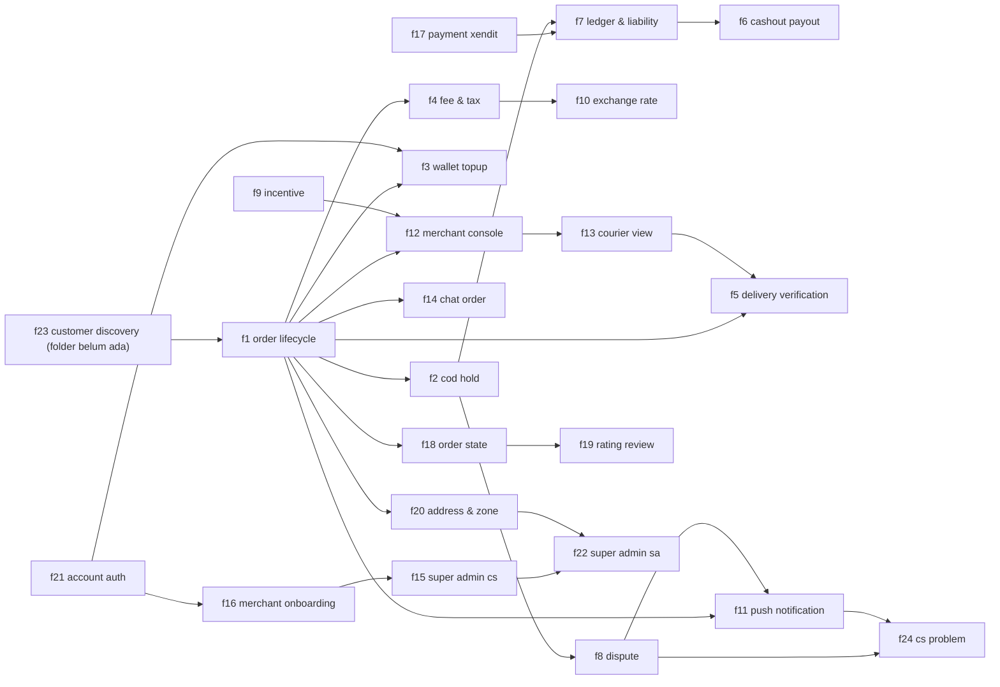

### 16.2 ERD (relasi utama)

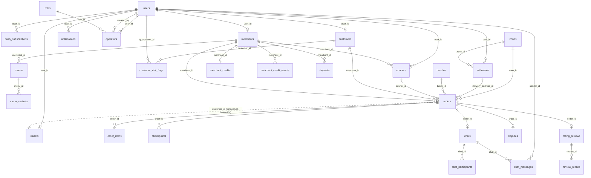

### 16.3 Journey order end-to-end + notifikasi (f1 + f11, `R-NOTIF-01`)

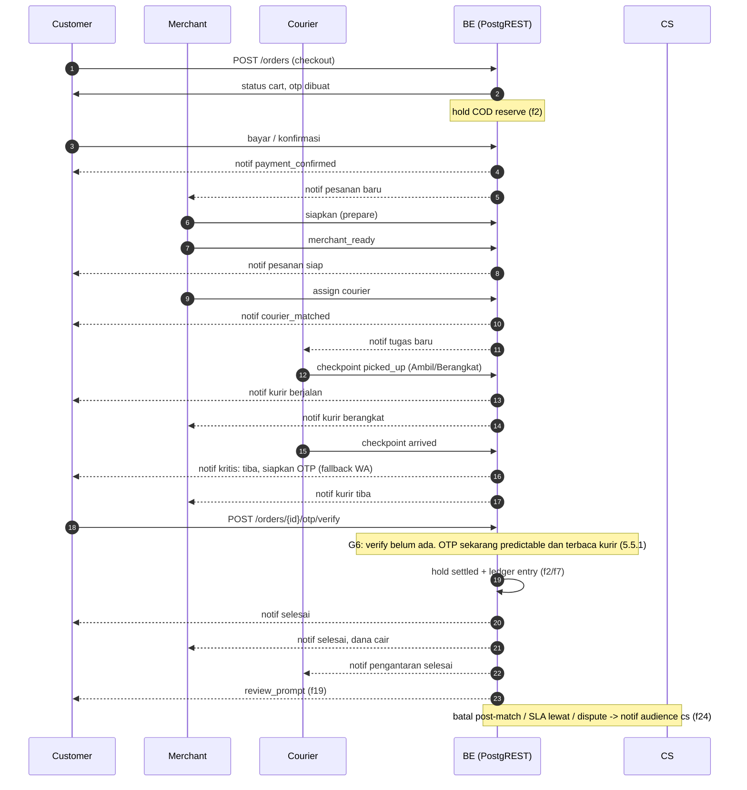

### 16.4 Order state + COD hold (f18 + f2)

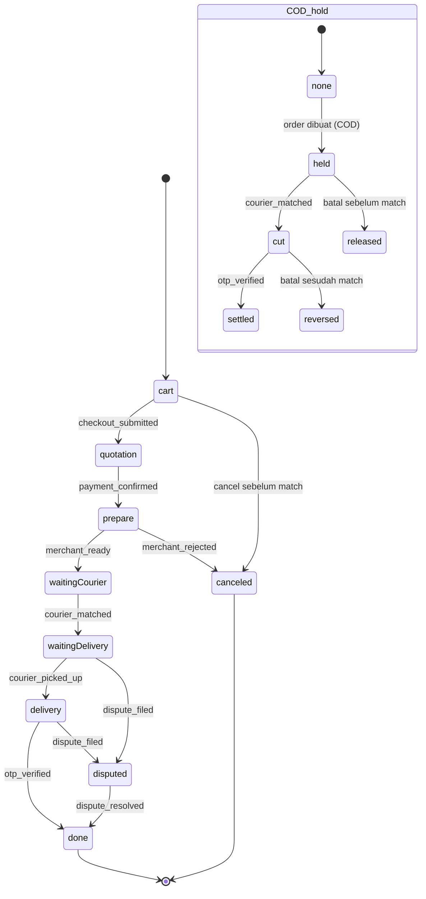

### 16.5 Uang: top-up gate + top-up (f3 + f21)

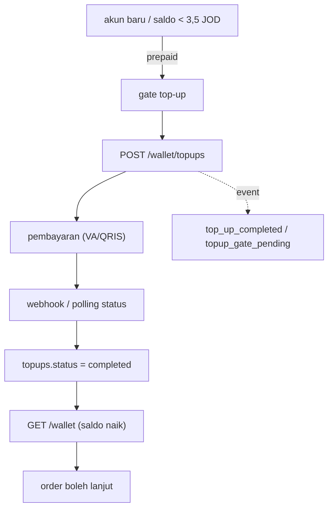

### 16.6 Pembayaran Xendit (f17)

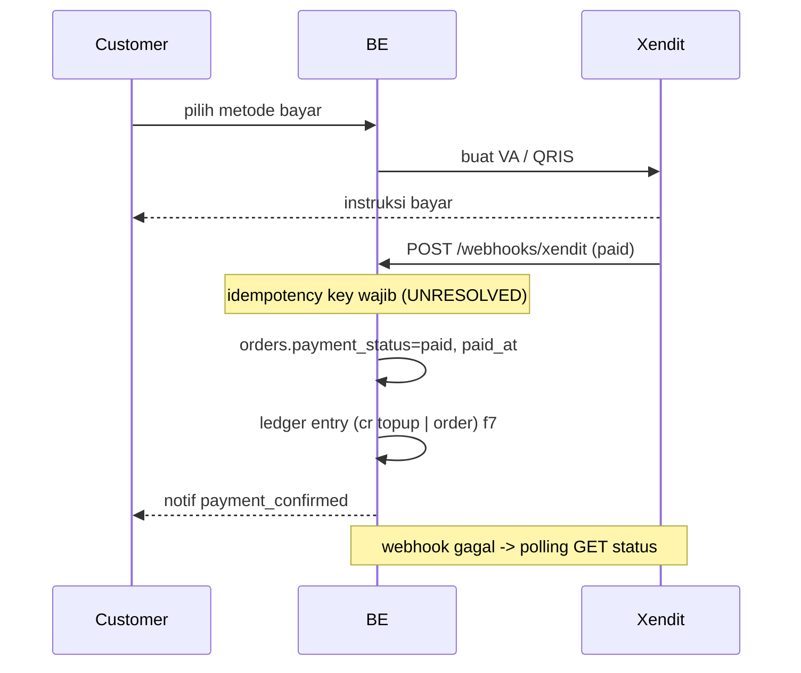

### 16.7 Ledger & liability (f7) + cashout (f6)

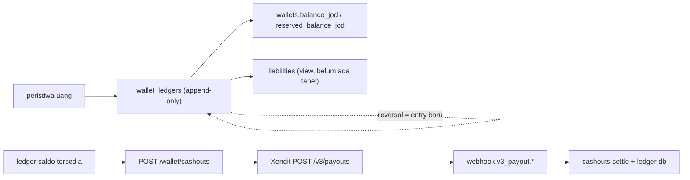

### 16.8 Fee & pajak (f4) + kurs (f10)

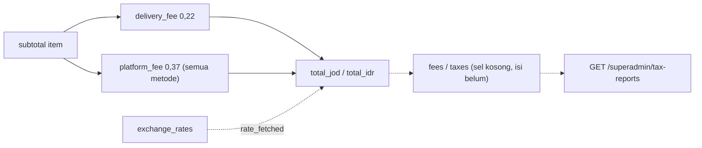

### 16.9 Verifikasi kirim + SLA (f5 + f13)

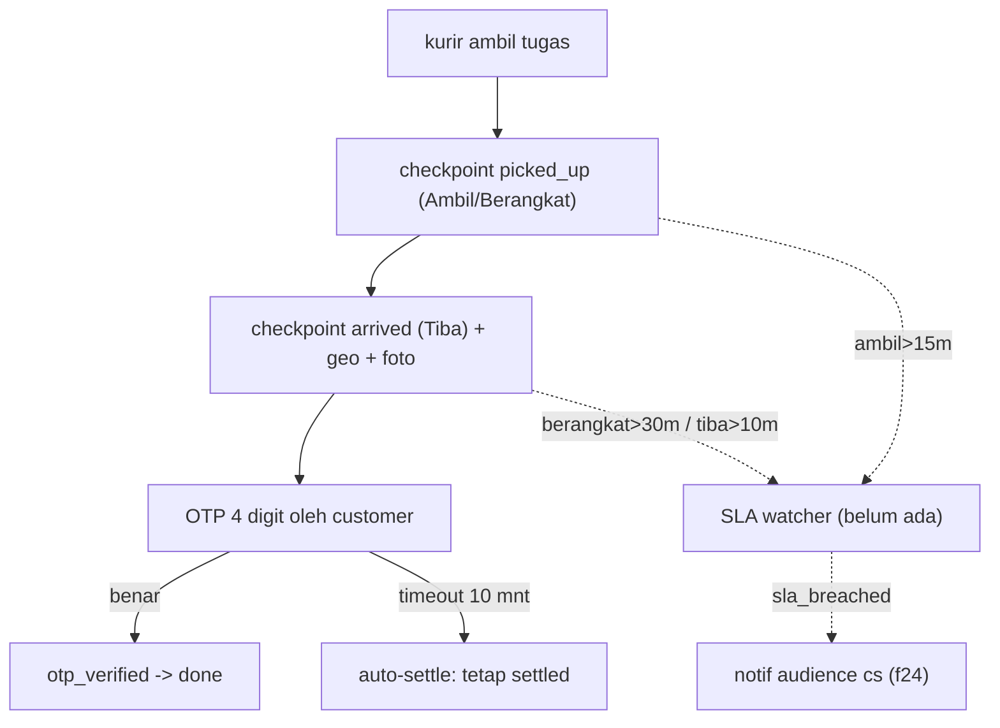

### 16.10 Merchant console (f12) + courier view (f13)

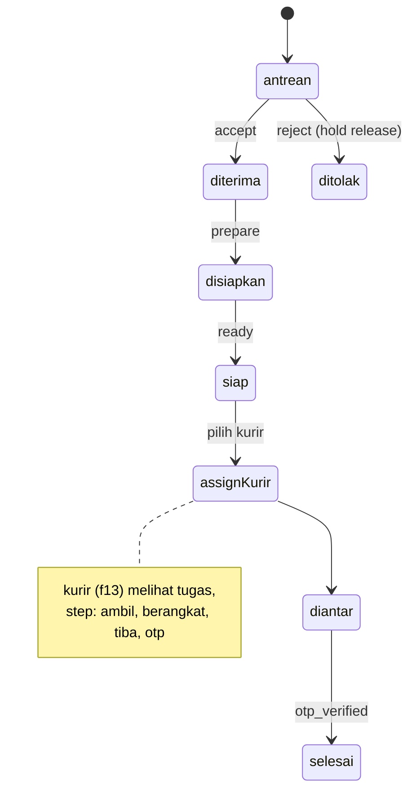

### 16.11 Push notification + fallback WA (f11, `R-PUSH-01`)

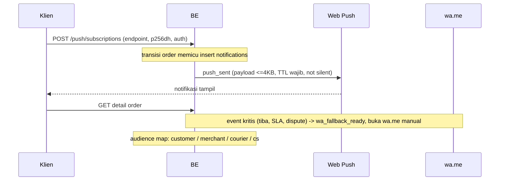

### 16.12 Chat per order (f14)

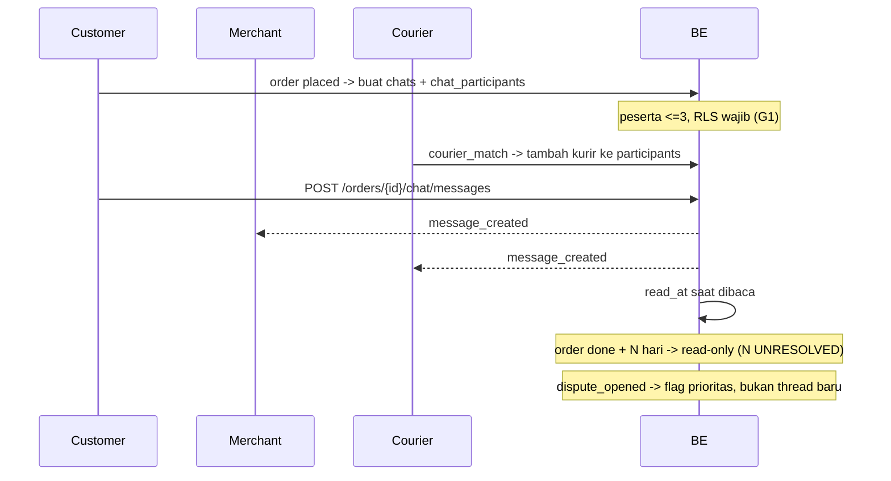

### 16.13 Dispute (f8)

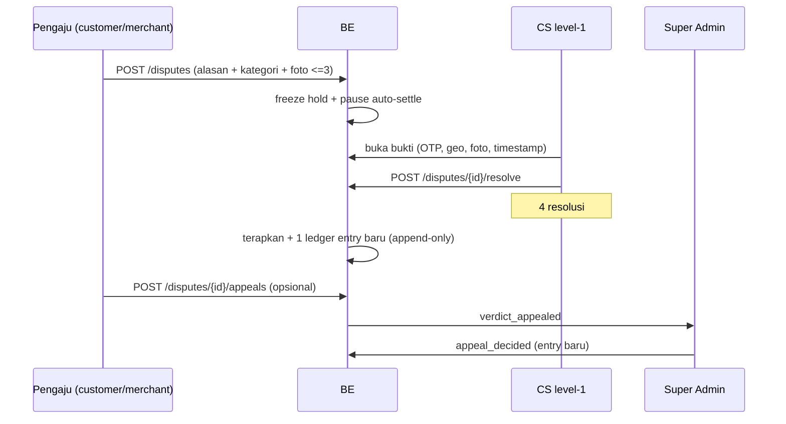

### 16.14 Penanganan masalah CS (f24)

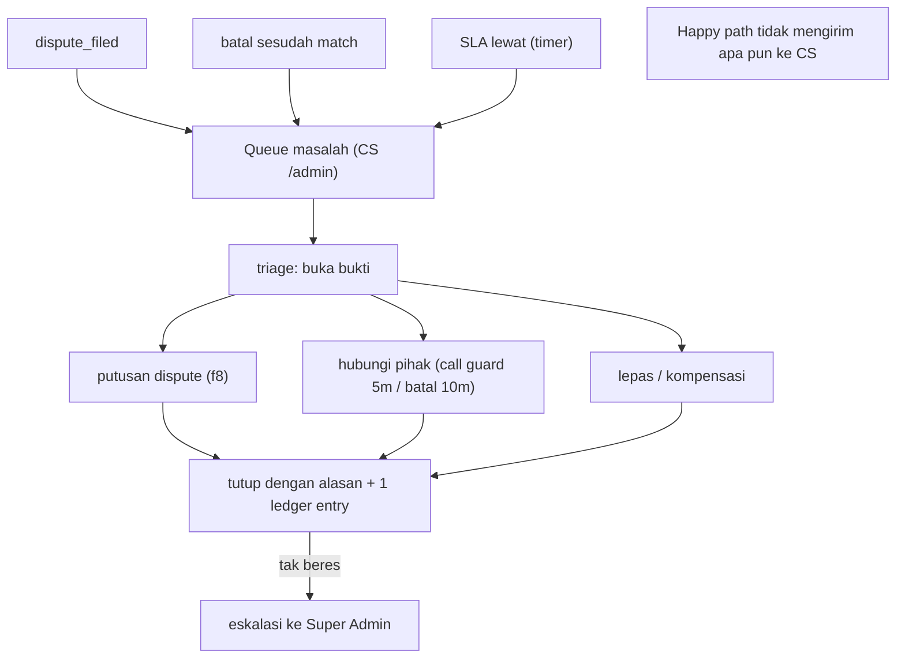

### 16.15 Customer discovery (f23, folder flow belum ada)

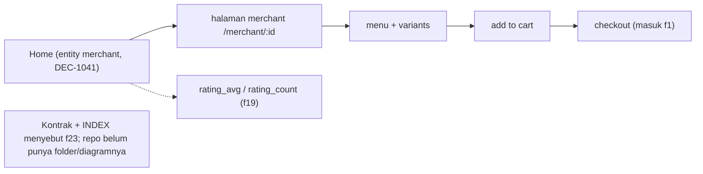

### 16.16 Address & zona (f20) + onboarding merchant (f16)

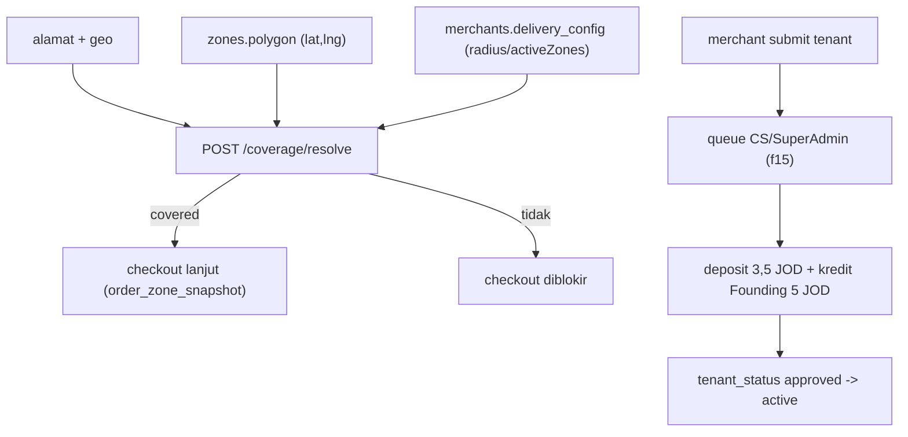

### 16.17 Auth & nomor WA (f21)

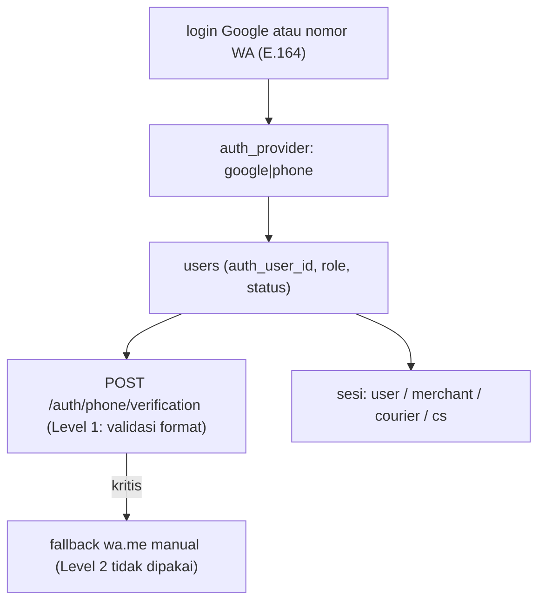

### 16.18 Rating & review + tip (f19)

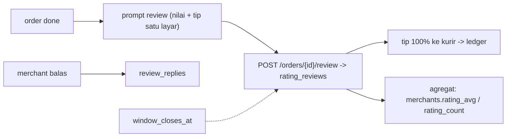

### 16.19 Insentif merchant (f9)

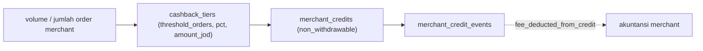

### 16.20 Konsol Super Admin (f15 + f22)

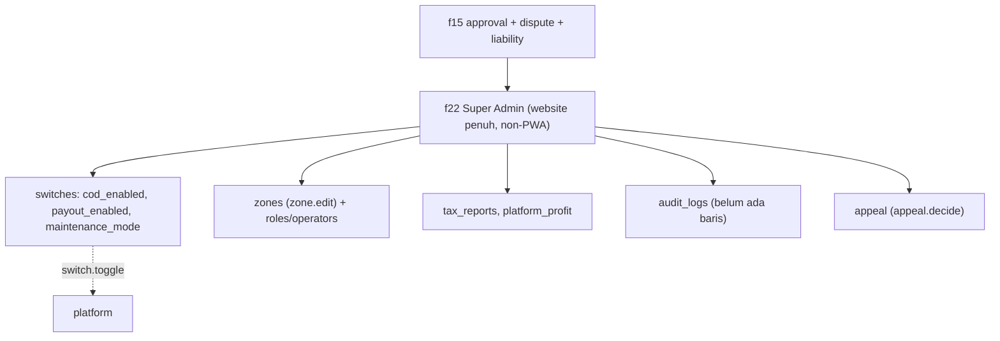

Catatan diagram:
- `f23-customer-discovery` digambar (§16.15) meski **folder flow belum ada** (M1).
- Diagram menggambarkan **layar/state + kebutuhan BE**; repo ini front-end (AGENTS.md §1).
- Nama event & state diambil dari `INDEX.json` (§`links`/`contract`) dan README flow.
